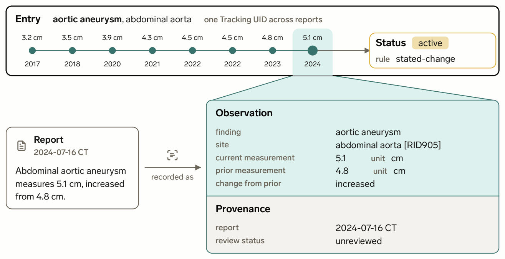
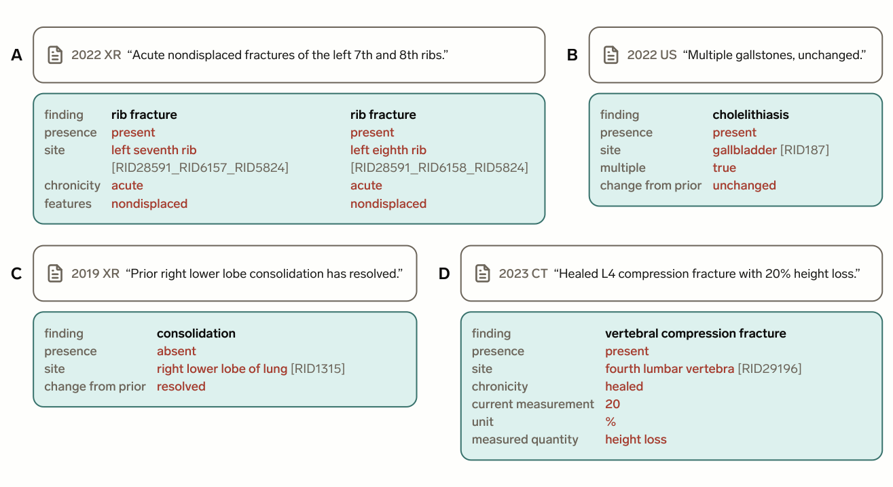

# Imaging Problem List exemplar

This repository specifies the Imaging Problem List (IPL) data model and holds one synthetic patient built to it. It accompanies the paper "The Imaging Problem List: A Data Model for Longitudinal Tracking of Imaging Findings" by Michael Hood, Dorothy A. Sippo, Stacy D. O'Connor, Neil Bhatia, Joel K. R. Samuel, Kevin O'Donnell, and Tarik Alkasab, in the Journal of Imaging Informatics in Medicine. Nothing here describes a real patient.

## The model

An IPL entry holds one finding a radiologist reports, such as one aortic aneurysm, across the examinations that describe it. The entry's identity is the finding's code and anatomic site. Its history holds each observation of the finding, recorded from one report sentence with that sentence's provenance and any review. The compiler derives the entry's status from that history by stated rules. The observations of one examination form its Exam Finding List (EFL).

<picture>
  <source media="(prefers-color-scheme: dark)" srcset="docs/fig_02_entry_anatomy.dark.png">
  
</picture>

Each observation records coded values, never the report's words, except for the site words that its provenance keeps as the evidence for the site code:

<picture>
  <source media="(prefers-color-scheme: dark)" srcset="docs/fig_03_sentence_coding.dark.png">
  
</picture>

## Repository contents

| Path | Contents |
|---|---|
| `scripts/spec/` | The JSON Schema for an observation, an EFL, and the IPL, and the FHIR code systems and extensions in FHIR Shorthand |
| `scripts/exemplar.py` | What each synthetic report says: the patient, examinations, concepts, and findings |
| `scripts/build_exemplar.py` | The rules that group observations into entries and derive each status, and the writers |
| `scripts/field_table.py` | Renders the field table from the schema |
| `scripts/fhir_example.py` | Builds the worked FHIR example of the aneurysm entry |
| `data/raw/` | The inputs, each with its source and licence in `data/README.md` |
| `data/derived/` | What the scripts write: the EFLs, the IPL, the field table, and the FHIR definitions and worked example |
| `docs/` | The figures in this README |

The field table, `data/derived/field_table.md`, gives each element its meaning, cardinality, binding, FHIR R5 and R6 paths, DICOM SR concept, and whether core FHIR, an IHE IDR convention, an IPL extension, or nothing yet represents it.

## Build and check

Install the two libraries the build uses, which needs Python 3.11 or later:

```
python3 -m pip install -r requirements.txt
```

1. Build the EFLs and the IPL. The script validates every file against the schema and exits nonzero on the first failure:

   ```
   python3 scripts/build_exemplar.py
   ```

2. Render the field table:

   ```
   python3 scripts/field_table.py
   ```

3. Compile the FHIR code systems and extensions with SUSHI, which needs Node.js:

   ```
   npx --yes fsh-sushi@3.21.0 build scripts/spec/fhir -o data/derived/fhir/definitions
   ```

4. Build the worked FHIR example, a Bundle of the aneurysm entry's reports, observations, BodyStructures, List, and Provenance:

   ```
   python3 scripts/fhir_example.py
   ```

5. Check the worked example with the HL7 FHIR validator 7.0.5, `validator_cli.jar` from the [HAPI FHIR core releases](https://github.com/hapifhir/org.hl7.fhir.core/releases/tag/7.0.5), which needs Java:

   ```
   java -jar validator_cli.jar -version 5.0.0 \
     -ig data/raw/fhir/hl7.terminology.r5-7.5.0.tgz \
     -ig data/raw/fhir/hl7.fhir.uv.extensions.r5-5.4.0.tgz \
     -ig data/derived/fhir/definitions/fsh-generated/resources \
     data/derived/fhir/aneurysm-example.json
   ```

   The validator reports no errors. It warns that it can't load the Open Imaging Finding Model (OIFM) and Anatomic Locations Index code systems, so it doesn't check codes from either one.

The worked example's review history is illustrative, since no model read the synthetic reports, and each resource's narrative says so.

## Codes

Finding codes come from the [Open Imaging Finding Models registry](https://github.com/openimagingdata/findingmodels), with definitions in `data/raw/finding_models/` for codes the registry doesn't publish. Anatomic sites come from the [Anatomic Locations Index](https://www.anatomiclocations.org) 1.0.0, procedures from LOINC, presence from SNOMED CT, and units from UCUM. The field table's DICOM concepts follow DICOM PS3.16 2026d, which this repository doesn't redistribute.

## License

The code is licensed under the Apache License 2.0, in the `LICENSE` file, and the data under CC BY 4.0, in the `LICENSE-DATA` file. Each input in `data/raw/` keeps its own licence, as `data/README.md` lists.

## Citation

Zenodo archives each release under the DOI [10.5281/zenodo.24444002](https://doi.org/10.5281/zenodo.24444002), which resolves to the newest version. Version 2.0.0, the release the paper describes, is [10.5281/zenodo.24444003](https://doi.org/10.5281/zenodo.24444003). For the citation, see the `CITATION.cff` file.
